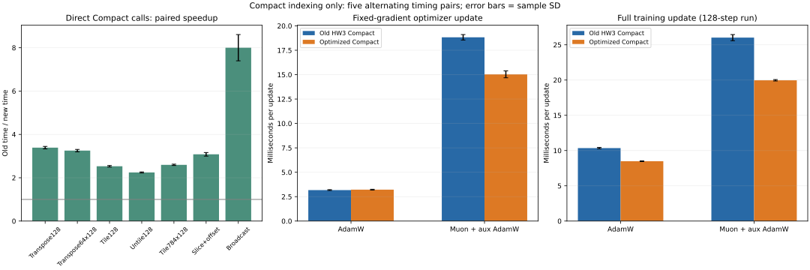

# Compact coordinate-carry optimization

The final backend uses direct nested loops for rank two and coordinate carry for other ranks. Only Compact indexing and standard headers changed; both optimizers use the same improved backend. All paired output hashes are identical.

## Direct native copy measurements

Five sequential alternating old/new process pairs. Each cell is the median time over five repetitions; each repetition averages 1,000 preallocated native calls. Python-to-native dispatch is included; output allocation is excluded. Speedup is the median of within-pair old/new ratios, which need not equal the ratio of medians.

| Layout | Old, microseconds/call | Final, microseconds/call | Paired median speedup |
|---|---:|---:|---:|
| transpose128 | 27.223 | 7.995 | 3.383x |
| transpose64x128 | 14.231 | 4.357 | 3.268x |
| tile128 | 57.712 | 22.741 | 2.538x |
| untile128 | 57.782 | 25.853 | 2.234x |
| tile784x128 | 350.396 | 134.643 | 2.602x |
| slice_offset | 7.285 | 2.347 | 3.072x |
| broadcast | 7.490 | 0.920 | 8.148x |

## Optimizer and short training measurements

| Workload | Old, ms/update | Final, ms/update | Paired median speedup |
|---|---:|---:|---:|
| optimizer_adamw | 3.179 | 3.207 | 0.996x |
| optimizer_muon | 18.875 | 14.923 | 1.263x |
| training_adamw | 10.373 | 8.496 | 1.222x |
| training_muon | 25.820 | 19.966 | 1.299x |

Fixed-gradient updates have ten warmup steps followed by 100 measured steps. Training uses the deep Fashion-MNIST encoder, seed 8, batch 64 and 128 updates. The full training loop includes batch preparation, forward/backward and updates; it excludes setup, data loading and final feature evaluation. All final parameters, all 128 training losses, and features for 128 validation images match bit-for-bit between versions. Five blocks are timing repetitions of the same seed, not five independent model-quality trials.



## Measured refinement: generic carry alone is not universally faster

The initial all-ranks carry implementation regressed two-dimensional copies. The full raw trial and measured native source are retained in generic_carry/. This motivated direct row/column loops for rank two. The final 2D non-regression checks all pass. The initial and final trials are separate measurement rounds; their normalized speedups are each paired against the old backend.

| Layout | Initial generic carry vs old | Final implementation vs old |
|---|---:|---:|
| compact_transpose128 | 0.588x | 3.383x |
| compact_broadcast | 0.609x | 8.148x |
| compact_slice_offset | 0.872x | 3.072x |
| compact_tile128 | 2.564x | 2.538x |

## Why the optimizer became faster

Separate instrumented fixed-gradient diagnostics retain 45 matrix products and 157 native compactions per Muon hybrid update in both versions. The change makes copies cheaper; it does not remove them.

| Native operation within Muon | Old, ms/update | Final, ms/update |
|---|---:|---:|
| compact | 6.693 | 2.674 |
| matmul_tiled | 7.827 | 7.798 |

Instrumented kernel times are descriptive and include timing overhead; primary speedups use uninstrumented runs. Native matrix algorithms were unchanged. The generic path adds one O(rank) coordinate vector per call; the two-dimensional path avoids it. All these costs are included.

## Validation, provenance and limits

- The rebuilt final backend passes 105 project tests, including independent bit-preservation/source-preservation checks over 109 valid layouts, scalar/empty arrays, signed/zero strides, offsets and six-dimensional cases.
- Before the edit, old-vs-old control yielded 1.008x on the representative tiled case, correctly failing the predefined 1.2x target.
- Compiler/flags are identical across variants; source and binary hashes, all raw pairs, initial regression results and compiler details are retained.
- Muon/AdamW formulas, learning rates, parameter groups, matmul kernels, Python tile/untile conversion and quantization are unchanged.
- This establishes execution speed at fixed work. It does not demonstrate that Muon beats AdamW at equal time, nor provide new retrieval-quality results.
- Historical training/search reports refer to baseline commit `efe063d3b67153ced96c8435a381866ee0077605`. Their source-hash validators should be run at their recorded revision.

## Reproduction

```bash
python experiments/benchmark_compact_optimization.py --require-speedup 1.2
python experiments/summarize_compact_optimization.py
```

The baseline is compiled from the recorded Git C++ source, while both variants share the same Python/model/optimizer code. Temporary backend snapshots and binary/model/data artifacts stay under ignored results/ paths. See [the durable implementation log](../../docs/project_change_log.md) for the report-writing context.
