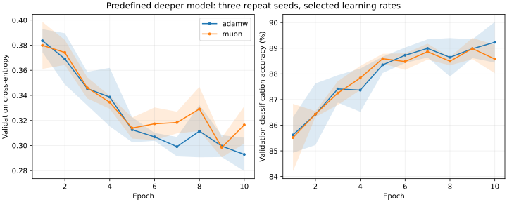
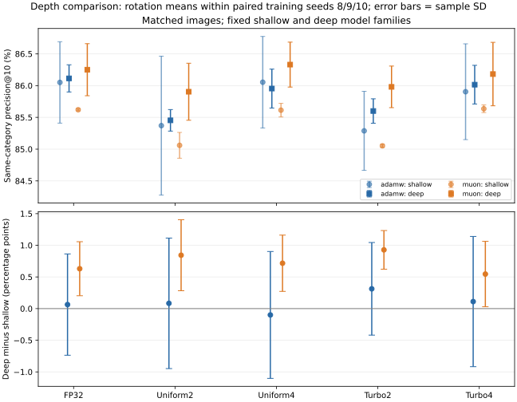
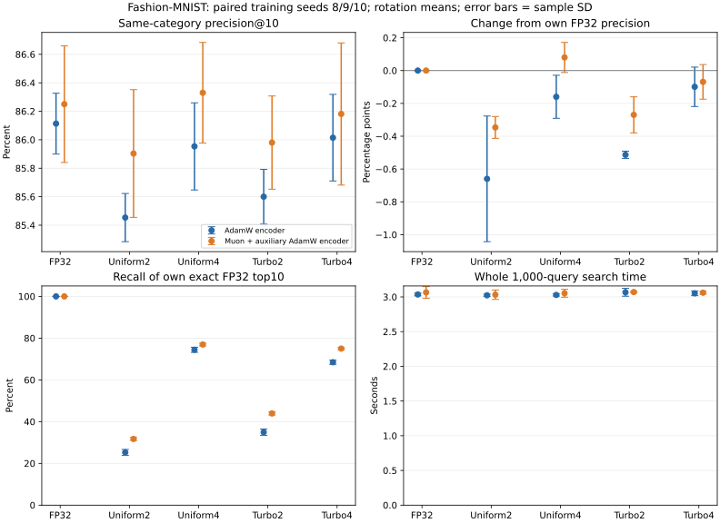

# Depth-only Muon and quantized retrieval study

The predefined deeper model has 142,410 parameters, with 40,960 (28.76%) assigned to Muon versus 7.49% in the shallow model. Uncompressed retrieval category precision@10 is 86.11% for deep AdamW and 86.25% for deep Muon plus auxiliary AdamW. The tables retain all seeds, stores and both model depths; no retrieval result selects the setup.

Deep Muon+TurboQuant2-bit retrieval averages 85.98%, versus 85.05% for shallow Muon and 85.60% for deep AdamW. The paired deep-Muon advantage is +0.380 percentage points, with wins in 2/3 training seeds. Ten-epoch CPU loops take 220.03s for Muon versus 87.76s for AdamW (2.51x). These small-sample retrieval gains do not establish better classification, faster training or a general optimizer ranking.

## Architecture and fixed procedure

Old: 784-128-64-10. New: 784-128-128-128-64-10. Two added 128-to128 Linear+ReLU layers increase depth while width 128 and embedding 64 remain fixed. Muon handles both added matrices and the 128x64 embedding weight. Input/classifier weights and all biases use AdamW. This is a plain MLP with the original initialization/loss; no new normalization, residual connections, dropout or quantizer changes.

The [predeclared design](../../docs/depth_study_design.md) fixes Fashion-MNIST: 55,000 training/5,000 validation images (split 17), batch 64, ten epochs, decay 0.01. Search seed 7 selects minimum validation loss from three configurations per optimizer; lock choices before repeat seeds 8/9/10. Repeat checkpoints also use minimum validation loss. Deeper models are retuned with the same candidate budget rather than inheriting the shallow winner. Both rates in a Muon candidate move together; no independent 2D search or schedule/decay tuning is performed.

The retrieval phase reuses the exact shallow 55,000 gallery and 1,000 query image IDs, confirmed by data/ID hashes. Each encoder generates its own gallery/query embeddings; only gallery vectors are compressed. Native cosine top10, blocks of 256, FP32/uniform2/4 and TurboQuant-MSE2/4; Turbo rotations 7/8/9. Three sequential query timings follow warmup. Average rotations within training seed, then mean/sample SD over three seeds.

## All learning-rate candidates (seed7)

| Method | Candidate | AdamW/auxiliary rate | Muon matrix rate | Minimum validation loss | Accuracy at selected checkpoint |
|---|---|---:|---:|---:|---:|
| adamw | low | 0.001 | - | 0.289460 | 89.56% |
| adamw | medium | 0.003 | - | 0.298589 | 88.96% |
| adamw | high | 0.01 | - | 0.392996 | 86.48% |
| muon | low | 0.001 | 0.007 | 0.309053 | 88.98% |
| muon | medium | 0.003 | 0.02 | 0.350303 | 87.94% |
| muon | high | 0.01 | 0.06 | 0.598772 | 80.12% |

## Selected deep training and classification results

| Method | Candidate | Validation accuracy | Official test accuracy | Ten-epoch CPU training seconds | Numeric state bytes | Selected epochs |
|---|---|---:|---:|---:|---:|---|
| adamw | low | 89.39% +/- 0.53 | 88.32% +/- 0.43 | 87.76 +/- 0.34 | 1,139,280 | [9, 10, 10] |
| muon | low | 88.99% +/- 0.41 | 87.87% +/- 0.28 | 220.03 +/- 0.16 | 975,440 | [9, 9, 9] |

Classification is separate from retrieval. Training-loop time excludes loading, validation and checkpoint I/O. Numeric state excludes parameters, gradients, Python objects and transient Newton-Schulz workspace; it is not peak memory. Three seeds are not confidence intervals. A grid endpoint or late selected epoch signals remaining tuning/budget uncertainty; no extra candidates/epochs were added after outcomes.



## Primary retrieval result: fraction of top10 sharing query category

| Store | Shallow AdamW | Shallow Muon | Deep AdamW | Deep Muon |
|---|---:|---:|---:|---:|
| fp32 | 86.05% +/- 0.64 | 85.62% +/- 0.02 | 86.11% +/- 0.21 | 86.25% +/- 0.41 |
| uniform_2 | 85.37% +/- 1.09 | 85.06% +/- 0.20 | 85.45% +/- 0.17 | 85.90% +/- 0.45 |
| uniform_4 | 86.05% +/- 0.72 | 85.61% +/- 0.11 | 85.95% +/- 0.31 | 86.33% +/- 0.35 |
| turbo_2 | 85.29% +/- 0.62 | 85.05% +/- 0.02 | 85.60% +/- 0.19 | 85.98% +/- 0.33 |
| turbo_4 | 85.90% +/- 0.75 | 85.64% +/- 0.06 | 86.01% +/- 0.30 | 86.18% +/- 0.50 |

This category-level metric counts retrieved true labels; it is not classification accuracy or exact-neighbor recall. Models use a classification objective rather than metric-learning training. Parameter count/compute and later-layer initialization differ between depths, so this is a model-family comparison, not isolated proof of a Muon coverage mechanism.



## Paired effects of added depth

Each difference uses matching training seed and image IDs. Positive optimizer-by-depth means the deeper architecture changes Muon's relative category-precision gap versus AdamW favorably. It does not prove why, or establish general superiority.

| Store | Deep-shallow AdamW (pp) | Deep-shallow Muon (pp) | Optimizer-by-depth (pp) |
|---|---:|---:|---:|
| fp32 | +0.063 +/- 0.800 | +0.630 +/- 0.427 | +0.567 +/- 0.951 |
| uniform_2 | +0.083 +/- 1.031 | +0.843 +/- 0.561 | +0.760 +/- 0.626 |
| uniform_4 | -0.100 +/- 1.002 | +0.717 +/- 0.444 | +0.817 +/- 1.095 |
| turbo_2 | +0.312 +/- 0.732 | +0.928 +/- 0.305 | +0.616 +/- 0.709 |
| turbo_4 | +0.111 +/- 1.028 | +0.546 +/- 0.517 | +0.434 +/- 1.174 |

## Deep compression-induced changes and neighbor fidelity

Compression changes are relative to each deep encoder's own FP32 category precision. Positive changes are retained. Neighbor recall instead measures overlap with that same encoder's exact FP32 top10. A lower compression loss can coexist with a lower absolute category precision.

| Store | AdamW category change (pp) | Muon category change (pp) | AdamW own-FP32 recall | Muon own-FP32 recall |
|---|---:|---:|---:|---:|
| fp32 | +0.000 | +0.000 | 100.00% +/- 0.00 | 100.00% +/- 0.00 |
| uniform_2 | -0.660 | -0.347 | 25.26% +/- 1.44 | 31.70% +/- 0.73 |
| uniform_4 | -0.160 | +0.080 | 74.42% +/- 1.21 | 76.94% +/- 0.64 |
| turbo_2 | -0.513 | -0.270 | 34.95% +/- 1.51 | 43.93% +/- 0.77 |
| turbo_4 | -0.099 | -0.069 | 68.46% +/- 1.00 | 74.99% +/- 0.49 |



## Storage and query time

| Store | Gallery MB (all depths/encoders) | Deep AdamW 1,000-query seconds | Deep Muon 1,000-query seconds |
|---|---:|---:|---:|
| fp32 | 14.0800 | 3.036 | 3.065 |
| uniform_2 | 1.3200 | 3.024 | 3.032 |
| uniform_4 | 2.2000 | 3.029 | 3.053 |
| turbo_2 | 1.1164 | 3.067 | 3.070 |
| turbo_4 | 1.9964 | 3.052 | 3.061 |

MB uses 1,000,000 bytes. Index size is fixed by 55,000x64 vectors and format, including persistent quantizer metadata, not model weights/images/queries/labels. Adding model layers cannot by itself shrink this fixed-format gallery. Query time includes normalization/rotation/block decode/native products/top-k, excluding embedding generation and construction. Raw rows retain all three timings, build cost, MSE and whole-worker peak RSS. Historical shallow timings were measured earlier on the same CPU, not interleaved with this study; do not read small temporal differences as depth-dependent search acceleration.

## Validation, limitations and reproduction

All six deep checkpoints reload to reproduce full 5,000-image validation scores. All 54 method rows verify checkpoint/archive/source provenance; common image IDs match the shallow study exactly. Shallow defaults, training/feature arrays and version1 checkpoint arrays reproduce exactly after adding the opt-in depth flag. Version2 stores/restores every extra layer. Original homework archives and optimizer/quantizer formulas remain unchanged.

Fashion official test images were already viewed in the earlier studies. This is a predefined exploratory depth extension; no untouched-test claim or post-result best-depth selection. More classes/different data is a separate experiment. The current data is clothing 10 categories, not handwritten digits. Native CPU float32 findings do not establish large-model/GPU speedups. Retained optimizer state reductions do not establish lower peak process memory.

```bash
python -m pytest -q
python experiments/run_depth_study.py
OPENBLAS_NUM_THREADS=1 OMP_NUM_THREADS=1 VECLIB_MAXIMUM_THREADS=1 python experiments/summarize_depth_study.py
```

A fresh full reproduction requires the earlier data and shallow-model records/artifacts. Archive published depth output before regenerating; source hashes and model checkpoints must match to resume. See historical commits for the original shallow protocol/source versions. All data/feature/checkpoint binaries stay local and ignored. [Summary JSON](summary.json), [training protocol](protocol.json) and [retrieval summary/per-worker rows](retrieval/summary.json) retain all measurements.
