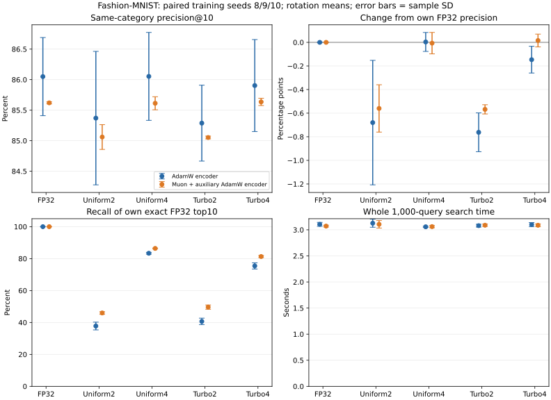

# Joint training-to-embedding-to-quantization retrieval study

Uncompressed same-category precision@10 is 86.05% for the tuned AdamW encoders and 85.62% for the tuned Muon plus auxiliary AdamW encoders. This measures retrieval, not the classification accuracy from the earlier study. Every quantizer below now consumes embeddings from the corresponding tuned model.

TurboQuant2-bit category precision is 85.29% with AdamW and 85.05% with Muon. Its gallery store uses 1.1164MB (12.61x compression). Muon has a smaller mean Turbo compression-induced category-precision loss, but its lower uncompressed retrieval baseline means the combined method does not exceed the AdamW counterpart in mean absolute category precision. Three paired training seeds and these CPU timings do not establish useful general synergy.

## Connected pipeline and fixed inputs

Fashion images -> fixed trained encoder -> 64D embeddings -> FP32/uniform/TurboQuant-MSE store -> native cosine top10 search. Each encoder supplies both its own gallery and query vectors; feature spaces from different models are never mixed. Only gallery vectors are compressed; queries remain float32. Store bytes exclude model weights, original images, evaluation labels and query vectors.

Use all three paired training seeds 8/9/10 from the [learning-rate study](../lr_dataset_study/summary.md). No retraining or best-seed selection. AdamW/auxiliary rate 0.001, Muon matrix rate 0.007; each checkpoint was previously selected by minimum validation loss. The gallery contains the same 55,000 training images in every archive, excluding the fixed 5,000-image split 17 validation holdout. Queries are the same 1,000 official-test image IDs. All use 64 features, cosine scoring, top10, blocks of 256 and native float32 CPU.

The [predeclared design](../../docs/joint_retrieval_design.md), [frozen protocol and model hashes](protocol.json), six feature metadata records and 18 raw comparison records make this chain auditable. Each feature archive was verified against its own checkpoint and common image IDs/labels before timing.

## Primary task quality: same-category precision@10

For each query, retrieve ten images and count the fraction sharing its clothing category; average over 1,000 queries. This is category-level retrieval, not an instance-level relevance judgment. Values are mean +/- sample SD over three training seeds after first averaging Turbo rotations 7/8/9 within each seed.

| Store | AdamW encoder | Muon encoder | Paired Muon minus AdamW (pp) |
|---|---:|---:|---:|
| fp32 | 86.05% +/- 0.64 | 85.62% +/- 0.02 | -0.430 +/- 0.641 |
| uniform_2 | 85.37% +/- 1.09 | 85.06% +/- 0.20 | -0.310 +/- 0.892 |
| uniform_4 | 86.05% +/- 0.72 | 85.61% +/- 0.11 | -0.440 +/- 0.763 |
| turbo_2 | 85.29% +/- 0.62 | 85.05% +/- 0.02 | -0.236 +/- 0.639 |
| turbo_4 | 85.90% +/- 0.75 | 85.64% +/- 0.06 | -0.268 +/- 0.808 |

FP32 is a separate baseline for each trained model. Higher absolute precision means better category retrieval in this evaluation; it does not establish which optimizer is generally better. Both encoders were trained with a classification objective, not a dedicated metric-learning objective.



## Compression-induced task change and interaction

Changes below are compressed precision minus that encoder's own FP32 precision. Negative means a drop; positive means compression happened to improve category precision. Do not clamp gains to zero. Interaction is Muon's change minus AdamW's change: positive means Muon loses less or gains more on this metric. A favorable interaction can coexist with worse absolute precision, so read both tables.

| Store | AdamW change (pp) | Muon change (pp) | Paired interaction (pp) |
|---|---:|---:|---:|
| uniform_2 | -0.680 | -0.560 | +0.120 +/- 0.380 |
| uniform_4 | +0.003 | -0.007 | -0.010 +/- 0.139 |
| turbo_2 | -0.762 | -0.568 | +0.194 +/- 0.198 |
| turbo_4 | -0.147 | +0.016 | +0.162 +/- 0.167 |

## Exact-neighbor fidelity (different from category precision)

Recall@10 measures overlap with that same model's own uncompressed cosine top10 image IDs. It measures how faithfully compression preserves the original search. The two encoders have different exact neighbors; they are not compared against a shared encoder's neighbor list.

| Store | AdamW own-FP32 recall@10 | Muon own-FP32 recall@10 |
|---|---:|---:|
| fp32 | 100.00% +/- 0.00 | 100.00% +/- 0.00 |
| uniform_2 | 37.78% +/- 2.43 | 45.96% +/- 0.84 |
| uniform_4 | 83.35% +/- 0.54 | 86.38% +/- 0.21 |
| turbo_2 | 40.68% +/- 2.02 | 49.63% +/- 1.32 |
| turbo_4 | 75.43% +/- 1.93 | 81.30% +/- 0.66 |

## Storage and query cost

| Store | Persistent MB (both encoders) | Compression vs FP32 | AdamW query batch seconds | Muon query batch seconds |
|---|---:|---:|---:|---:|
| fp32 | 14.0800 | 1.000x | 3.105 +/- 0.038 | 3.071 +/- 0.017 |
| uniform_2 | 1.3200 | 10.667x | 3.127 +/- 0.078 | 3.106 +/- 0.072 |
| uniform_4 | 2.2000 | 6.400x | 3.058 +/- 0.013 | 3.061 +/- 0.022 |
| turbo_2 | 1.1164 | 12.612x | 3.080 +/- 0.027 | 3.088 +/- 0.023 |
| turbo_4 | 1.9964 | 7.053x | 3.100 +/- 0.039 | 3.087 +/- 0.027 |

MB uses 1,000,000 bytes. Stores include packed codes and all persistent numerical metadata, including Turbo rotation/codebooks and per-row norms. Equal bit width does not imply equal total bytes. Storage is identical across encoders at fixed shape/format. This is not peak process memory.

Query times cover the whole 1,000-query batch, including input normalization, rotation, block decode, decoded-vector normalization, native matrix products and top-k merging. They exclude model feature generation and index construction. Each worker warms up once and retains three timings. Aggregate each rotation's median within training seed, then average the three training seeds. All retained workers run sequentially. Per-worker construction time, reconstruction MSE, storage breakdown and whole-worker peak RSS remain in the raw JSON; RSS is not isolated query-only memory.

## Feature geometry and limits

| Encoder | Mean feature zero fraction | Query classification accuracy (diagnostic only) |
|---|---:|---:|
| adamw | 51.30% | 87.33% |
| muon | 60.48% | 86.90% |

Sparsity differences are observations, not a causal explanation for compression behavior. The native quantizer/scorer formulas are unchanged. TurboQuant is the MSE variant with 2/4-bit coordinate codes, not QJL. Rotation trials are not nine independent trained models. Error bars/sample SD describe only three training seeds, not confidence intervals. Previous classification test results already exposed Fashion test data; this is a fixed-model retrieval extension, not an untouched final test. No retrieval result selects a checkpoint, dataset or configuration.

Training cost remains separate: the tuned Muon encoders took longer per ten epochs on this CPU in the earlier study. A compression-quality advantage alone would not establish an end-to-end training or query speedup. Old MNIST quantization records remain historical comparisons on their original encoder.

## Reproduction and validation

All six original checkpoint hashes and dataset hashes match. Common gallery/query IDs and labels match across all models, and the validation holdout is excluded. First 64 gallery and query embeddings for each model reproduce exactly from its own checkpoint. All 18 raw records/54 method workers pass provenance, shape, metric, storage and completeness checks. FP32 recall is 100% by construction for each model. The old default MNIST export reproduces every saved array/source exactly.

```bash
python -m pytest -q
python experiments/run_joint_retrieval.py
OPENBLAS_NUM_THREADS=1 OMP_NUM_THREADS=1 VECLIB_MAXIMUM_THREADS=1 python experiments/summarize_joint_retrieval.py
```

Data, checkpoints and feature NPZ files remain ignored. Full reproduction requires regenerating the local models/records following the learning-rate study. Archive the published joint report directory outside this output path before regenerating it; existing records resume only with matching sources and artifacts. [Full summary and per-worker rows](summary.json) contain all values and hashes. Matplotlib is optional analysis tooling, not a Needle runtime dependency.
