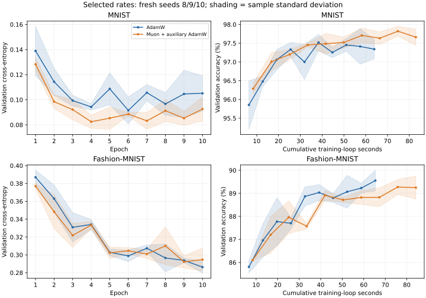

# AdamW and Muon: learning-rate tuning and Fashion-MNIST

After the fixed three-candidate search, fresh-seed MNIST validation accuracy is 97.52% for AdamW versus 97.65% for Muon plus auxiliary AdamW. Final Fashion-MNIST test accuracy is 88.23% versus 88.25%, respectively. These are classification metrics, not retrieval precision. Validation and test results have different selection histories; compare methods within each dataset/split.

Muon ten-epoch CPU training loops take 29.9% longer on MNIST and 28.8% longer on Fashion-MNIST. The mean final Fashion accuracy gap (Muon minus AdamW) is +0.02 percentage points. Read the paired seed differences and training cost alongside the small mean gap; this setting does not establish general optimizer superiority.

The study follows the [predeclared design](../../docs/lr_dataset_study_design.md). It gives both methods three configurations per dataset, locks choices using seed 7 validation loss, then runs fresh seeds 8/9/10. All 24 ten-epoch trainings use the same 784-128-64-10 Needle float32 CPU encoder, 55,000 training/5,000 validation images (split17), batch 64, and weight decay0.01. No test data selects a rate or checkpoint.

## All search candidates (seed7)

| Dataset | Method | Candidate | AdamW/auxiliary rate | Muon matrix rate | Minimum validation loss | Accuracy at that checkpoint |
|---|---|---|---:|---:|---:|---:|
| MNIST | adamw | low | 0.001 | - | 0.079482 | 97.70% |
| MNIST | adamw | medium | 0.003 | - | 0.077264 | 97.82% |
| MNIST | adamw | high | 0.01 | - | 0.121704 | 96.92% |
| MNIST | muon | low | 0.001 | 0.007 | 0.077693 | 97.50% |
| MNIST | muon | medium | 0.003 | 0.02 | 0.106252 | 96.98% |
| MNIST | muon | high | 0.01 | 0.06 | 0.137616 | 96.62% |
| Fashion-MNIST | adamw | low | 0.001 | - | 0.292478 | 89.16% |
| Fashion-MNIST | adamw | medium | 0.003 | - | 0.312456 | 88.54% |
| Fashion-MNIST | adamw | high | 0.01 | - | 0.351842 | 87.42% |
| Fashion-MNIST | muon | low | 0.001 | 0.007 | 0.288783 | 89.16% |
| Fashion-MNIST | muon | medium | 0.003 | 0.02 | 0.323102 | 88.42% |
| Fashion-MNIST | muon | high | 0.01 | 0.06 | 0.424319 | 85.46% |

Each Muon configuration pairs a matrix rate with an auxiliary AdamW rate. This is three paired candidates, not an independent 2D search. Momentum 0.95, five Newton-Schulz steps and weight decay are fixed. Search seed 7 is excluded from the repeat averages. Rates/checkpoints are selected by loss, not accuracy.

## Fresh repeat results

| Dataset | Method | Selected candidate | Validation accuracy | Validation loss | Ten-epoch training seconds | Selected epochs |
|---|---|---|---:|---:|---:|---|
| MNIST | adamw | medium | 97.52% +/- 0.22 | 0.087605 | 63.93 +/- 0.45 | [6, 4, 6] |
| MNIST | muon | low | 97.65% +/- 0.22 | 0.081202 | 83.02 +/- 0.09 | [8, 4, 7] |
| Fashion-MNIST | adamw | low | 89.62% +/- 0.38 | 0.285622 | 65.39 +/- 0.39 | [6, 10, 10] |
| Fashion-MNIST | muon | low | 89.42% +/- 0.40 | 0.289289 | 84.21 +/- 0.90 | [9, 9, 10] |

Mean +/- sample standard deviation over seeds 8/9/10; these are not confidence intervals. Each repeat uses its minimum-validation-loss checkpoint. Validation data is reused for rate and checkpoint selection, so validation accuracy is selection-biased. Fresh means excluded from this study's seed 7 search: seeds 8/9 were already used in the earlier fixed-rate MNIST pilot. These are newly executed locked-configuration trials, not additional independent samples to pool with the old ones.



## Final Fashion-MNIST test (10,000 images)

All rates, checkpoint hashes and training-record hashes were frozen in [evaluation_lock.json](evaluation_lock.json) before downloading/reading Fashion test files. Each of the six fixed repeat checkpoints is evaluated once; test results cause no retuning.

| Method | Test accuracy | Test cross-entropy |
|---|---:|---:|
| adamw | 88.23% +/- 0.19 | 0.331704 |
| muon | 88.25% +/- 0.28 | 0.333742 |

Paired Muon-minus-AdamW test-accuracy differences (percentage points): [0.41, 0.13, -0.48]; mean +0.020. Three seeds do not establish general optimizer superiority.

## Cost and interpretation

| Dataset | Method | Total three-candidate search training seconds | Mean optimizer update ms | Numeric state bytes |
|---|---|---:|---:|---:|
| MNIST | adamw | 194.05 | 2.055 | 875,088 |
| MNIST | muon | 252.11 | 4.271 | 842,320 |
| Fashion-MNIST | adamw | 190.16 | 2.181 | 875,088 |
| Fashion-MNIST | muon | 246.68 | 4.373 | 842,320 |

Training-loop timing includes forward/backward/update, excluding loading, validation and checkpoint I/O. Search budgets match by configurations and updates; elapsed cost can differ. Numeric state excludes parameters, gradients, Python overhead and transient Newton-Schulz workspace; it is not peak memory. CPU float32 results do not predict GPU speed.

Muon still updates only the 8,192-parameter hidden matrix out of 109,386 total parameters (about 7.5%). This small MLP, fixed decay, constant learning rates, short training budget and narrow paired grid limit conclusions. A selected endpoint does not establish an optimal rate. Changing dataset alone cannot establish why an optimizer differs; model and optimizer coverage remain unchanged. No additional candidates were added after outcomes.

Classification accuracy is not retrieval same-label precision. No compression was rerun; the older quantization numbers belong to their original fixed encoder. The old MNIST test has already been inspected in prior work and is not reported as an untouched final test here.

## Verification and reproduction

All paired initialization/data/split/order hashes agree. All 12 repeat checkpoint reloads reproduce their full 5,000-image validation metrics. Both medium seed 7 MNIST trajectories match the earlier pilot exactly. Dataset identity/export provenance, loss-only rate selection, pair rejection and sample statistics have regression checks.

Download the four official IDX gzip files into `data/fashion-mnist/`, checking the [published MD5 checksums](https://github.com/zalandoresearch/fashion-mnist#Get-the-Data). For the original staged protocol, acquire only training files first, run training, run the summarizer to create the evaluation lock, then acquire test files and rerun it.

Published records are paired with local ignored checkpoints. For full reproduction from a fresh clone, first move the published `reports/lr_dataset_study` directory to an archive outside that output path (for example, under `results/reproduction_archive`). Then run the commands below to produce new records and checkpoints. The runner deliberately refuses to treat an old record with a missing checkpoint as a complete run.

```bash
python -m pytest -q
python experiments/run_lr_dataset_study.py
OPENBLAS_NUM_THREADS=1 OMP_NUM_THREADS=1 VECLIB_MAXIMUM_THREADS=1 python experiments/summarize_lr_dataset_study.py
```

The runner resumes only complete, source-compatible recorded trials. Data/checkpoints/logs remain ignored; raw JSON, protocol, selections and hash lock are published here. [Full machine-readable results](summary.json) include every final test evaluation and repeat metric. Matplotlib is analysis-only.
