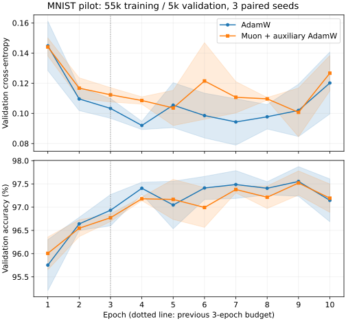

# Muon in Needle: paired training pilot

Real training preceded quantization: the old encoder used AdamW for three epochs. This study adds native Needle Muon and compares a longer budget with a fresh paired AdamW baseline. It does not reuse old quantizer results as evidence of optimizer quality.

In this predefined CPU setting, minimum-validation-loss checkpoints average 97.60% classification accuracy for AdamW and 97.39% for Muon plus auxiliary AdamW. Ten-epoch training loops average 64.45s and 84.40s, respectively. No accuracy or training-speed advantage is established for Muon in this pilot.

## Protocol

Both optimizers use the same 784-128-64-10 model, initialization and data order within each of seeds 7/8/9. A fixed split seed 17 reserves 5,000 MNIST training images for validation and trains on the other 55,000. Each run uses ten epochs, batch size 64 and native CPU (8,600 updates). Initialization/split/order hashes match every pair. Learning rates were predefined: AdamW 0.003, Muon 0.02; auxiliary AdamW uses the same 0.003 learning rate, betas (0.9,0.999), and epsilon 1e-8 as baseline. Decay is 0.01 for both groups. There was no learning-rate/schedule search.

Muon updates only hidden.weight; other parameters use AdamW. The [design](../docs/muon_design.md) pins the author implementation and records float32 versus bfloat16, transposed Linear layout and absent-gradient adaptations. An independent SVD/singular-value-polynomial oracle checks the matrix update. All 70 checks passed; legacy AdamW features reproduce bit-for-bit.

## Classification quality and training budget

| Optimizer | Epoch3 validation accuracy | Epoch10 validation accuracy | Accuracy of minimum-loss checkpoint | Selected epochs |
|---|---:|---:|---:|---|
| adamw | 96.93% +/- 0.34% | 97.15% +/- 0.46% | 97.60% +/- 0.28% | [7, 6, 4] |
| muon | 96.77% +/- 0.08% | 97.19% +/- 0.31% | 97.39% +/- 0.42% | [5, 9, 9] |

Values are mean +/- sample standard deviation across three training seeds, not confidence intervals. Checkpoint selection uses minimum validation loss, not maximum observed accuracy. All individual epoch metrics remain in the raw records.

Minimum-loss checkpoints occurred after epoch 3 in 6/6 runs. Selection within a longer budget helps, but fixed-epoch results show that the last model is not automatically the best.



A longer budget provides additional candidate checkpoints, but the final epoch need not be best. Lower training loss together with rising/fluctuating validation loss is a reason to use validation selection and investigate scheduling, rather than assuming that more epochs always improve generalization.

## CPU cost and retained optimizer state

| Optimizer | Ten-epoch training-loop seconds | Mean full training-step ms | Mean optimizer-update ms | Numeric state bytes |
|---|---:|---:|---:|---:|
| adamw | 64.45 +/- 0.31 | 7.494 | 2.076 | 875,088 |
| muon | 84.40 +/- 0.41 | 9.814 | 4.329 | 842,320 |

Training-loop time includes forward/backward/update and tensor preparation; it excludes data loading, validation and checkpoint I/O. The CPU operations are synchronous. Numeric state excludes parameters, gradients, Python objects and transient Newton-Schulz matrices, so it is not peak-memory usage. Most parameters are in the input layer and remain on AdamW; the total-state reduction is therefore modest.

## Time to validation targets

| Optimizer | Target accuracy | Reached runs | Mean training seconds among reached runs |
|---|---:|---:|---:|
| adamw | 95% | 3/3 | 6.44 |
| adamw | 97% | 3/3 | 23.60 |
| adamw | 98% | 0/3 | not reached |
| muon | 95% | 3/3 | 8.39 |
| muon | 97% | 3/3 | 33.88 |
| muon | 98% | 0/3 | not reached |

Thresholds 95/97/98% were specified before inspecting outcomes. Threshold time is observed at epoch boundaries, not interpolated between measurements. A mean over successful runs must be read alongside its reach count.

## Separate downstream inspection, seed7

Selected checkpoints were reloaded and their 5,000-image validation loss/accuracy reproduced. Both then used the same 4,096-image FP32 gallery and 1,000 old test-split queries under native cosine scoring. No compression is evaluated in this table.

| Optimizer | Query classification accuracy | FP32 retrieval same-label precision@10 |
|---|---:|---:|
| adamw | 97.80% | 97.15% |
| muon | 98.10% | 96.74% |

Classification accuracy and retrieval label precision are different metrics. This downstream table is one seed and exploratory; the official test split had already been viewed in earlier work and is not an untouched final benchmark. It did not select these checkpoints.

## Scope and next checks

These are paired, fixed-setting pilot results, not equal-budget hyperparameter-tuned evidence of general optimizer superiority. Float32 CPU, batch size 64, a small MLP and a single hidden-matrix Muon group differ from large-model GPU experiments. Assess quality together with elapsed time; more optimizer compute does not guarantee a better final model. The formal Fashion-MNIST and joint Muon/quantization study remain separate.

## Reproduce

```bash
python -m pytest -q
python - <<'PY'
import os, subprocess, sys
env = dict(os.environ, OPENBLAS_NUM_THREADS='1', OMP_NUM_THREADS='1', VECLIB_MAXIMUM_THREADS='1')
for seed, optimizer in [(7,'adamw'),(7,'muon'),(8,'muon'),(8,'adamw'),(9,'adamw'),(9,'muon')]:
    subprocess.run([sys.executable, 'apps/train_baseline.py', '--device', 'cpu', '--optimizer', optimizer, '--train-limit', '55000', '--validation-size', '5000', '--eval-limit', '5000', '--split-seed', '17', '--epochs', '10', '--seed', str(seed), '--lr', '.003', '--muon-lr', '.02', '--weight-decay', '.01', '--checkpoint-output', f'results/muon_pilot/{optimizer}_seed{seed}_last.npz', '--best-checkpoint-output', f'results/muon_pilot/{optimizer}_seed{seed}_best.npz', '--output', f'reports/muon_pilot_{optimizer}_seed{seed}.json'], check=True, env=env)
PY
OPENBLAS_NUM_THREADS=1 OMP_NUM_THREADS=1 VECLIB_MAXIMUM_THREADS=1 python experiments/summarize_muon_pilot.py
```

Plot regeneration requires Matplotlib in the analysis environment. It is not needed for optimizer execution. [Machine-readable summary](muon_pilot_summary.json) includes all hashes, targets and selected-model checks.

- [muon_pilot_adamw_seed7.json](muon_pilot_adamw_seed7.json)
- [muon_pilot_adamw_seed8.json](muon_pilot_adamw_seed8.json)
- [muon_pilot_adamw_seed9.json](muon_pilot_adamw_seed9.json)
- [muon_pilot_muon_seed7.json](muon_pilot_muon_seed7.json)
- [muon_pilot_muon_seed8.json](muon_pilot_muon_seed8.json)
- [muon_pilot_muon_seed9.json](muon_pilot_muon_seed9.json)
