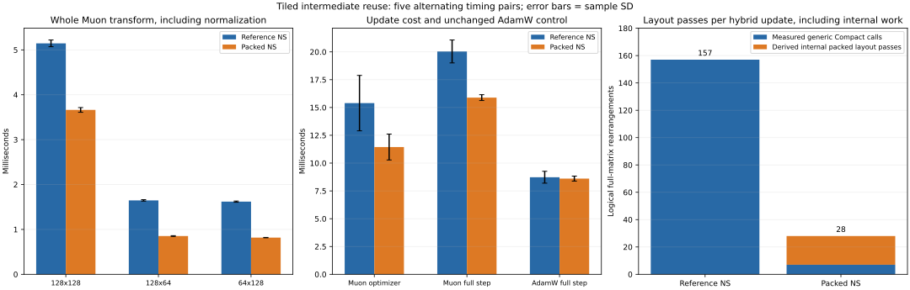

# Retaining tiled intermediates in Muon

The new native CPU NS path retains tiled intermediate matrices across all five iterations. Every measured transform, optimizer result and short training trace matches the reference path bit-for-bit. The reference and packed paths use the same binary and the previous Compact indexing optimization.

## Paired execution time

Five alternating sequential process pairs. Old/new columns are medians of the five per-process average times; speedup is the median of within-pair ratios. These are timing repetitions, not independent model-quality seeds.

| Workload | Reference, ms | Packed, ms | Paired median speedup |
|---|---:|---:|---:|
| transform_128x128 | 5.146 | 3.636 | 1.400x |
| transform_128x64 | 1.640 | 0.856 | 1.932x |
| transform_64x128 | 1.622 | 0.817 | 1.983x |
| optimizer_muon | 14.375 | 10.962 | 1.351x |
| optimizer_adamw | 3.133 | 3.117 | 1.005x |
| training_muon | 19.561 | 15.938 | 1.239x |
| training_adamw | 8.713 | 8.563 | 1.014x |

Transforms include the unchanged Frobenius normalization and final aspect scaling, with five warmups and 40 measured calls. Optimizer timing includes Muon and auxiliary AdamW, with ten warmups and 100 measured updates. Full training uses 128 updates of the deep Fashion-MNIST model, seed 8/batch 64, with the same split/order/rates. It includes tensor preparation, forward/backward and optimizer updates, excluding setup, data loading and final feature evaluation.

All final parameters, all 128 losses and 128 validation embeddings agree exactly across paths and reproduce the earlier Compact-stage fixed-step outputs. AdamW is an unchanged control. No new convergence or retrieval-quality result is inferred from these short execution-time measurements.



## What was reduced

The reference route packs both inputs and unpacks the result for each product. The new route packs X once and unpacks once per hidden matrix. X changes every iteration, so it still refreshes a tiled transpose five times. For three hidden matrices, this is 21 internal layout passes. Seven other generic compactions (normalization/broadcast/final orientation) remain.

| Work per hybrid optimizer update | Reference | Packed |
|---|---:|---:|
| Measured generic Compact calls | 157 | 7 |
| Derived internal packed layout passes | 0 | 21 |
| Total logical layout passes | 157 | 28 |
| Logical NS matrix products | 45 | 45 |
| Layout writes, decimal MB | 8.077312 | 1.441792 |

Generic Compact calls and their written-element counts are observed by the profiler. Internal passes/written elements are derived from native loop control and actual matrix dimensions, not hardware traffic counters. These transfers have different sizes; the byte column counts float32 elements written during layout conversion, not total process memory or actual DRAM traffic. Native NS time includes all its internal transposes, products and allocation work.

This local native implementation also removes per-operation Python dispatch and reuses scratch buffers. The experiment does not isolate the individual speed contributions of layout reuse, dispatch reduction and allocation reuse.

## Algorithm and validation

- MatmulTiled/AlignedDot arithmetic and accumulation order are reused. Scalar multiplication/addition stages remain separate to preserve float32 rounding.
- Momentum, coefficients, NS 5, Frobenius normalization, aspect scaling, weight decay and auxiliary AdamW are unchanged.
- `use_tiled_ns=True` selects supported aligned CPU matrices automatically. `use_tiled_ns=False` retains the reference. Unsupported sizes/backends fall back.
- The rebuilt backend passes 126 tests, including direct native bit parity, independent float64 SVD-polynomial oracles, multi-update optimizer states, zero/missing gradients, shape errors and routing.
- Five within-call scratch arrays hold 3RC+2R² floats in normalized orientation. They are released after each call; no persistent cache/state was added. This is not a claim about whole-process peak memory.
- Source, binary and data hashes and all raw pairs are retained. Historical experiments remain tied to their recorded revisions.

## Reproduction

```bash
python tools/build_cpu.py
python -m pytest -q
python experiments/benchmark_muon_tiled.py
python experiments/summarize_muon_tiled.py
```

See [the design](../../docs/muon_tiled_design.md) and [durable implementation log](../../docs/project_change_log.md) for report context.
