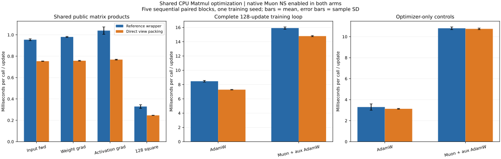

# Shared stride-aware CPU Matmul

Direct native packing from ordinary or transposed views speeds up the shared forward/backward path used by both optimizers. The existing Compact optimization and native tiled Muon NS path are enabled in both arms. MatmulTiled/AlignedDot arithmetic and optimizer formulas are unchanged.

## Paired timing

Five alternating sequential process pairs use the same final CPU binary. Columns are medians of five per-process average times; speedup is the median within-pair ratio. Full distributions, means and sample SD are in summary.json. Five blocks are timing repetitions, not independent model-quality seeds.

| Workload | Reference, ms | Direct packing, ms | Paired median speedup |
|---|---:|---:|---:|
| matmul_backward_activation | 1.027 | 0.769 | 1.334x |
| matmul_backward_weight | 0.981 | 0.758 | 1.295x |
| matmul_forward_input | 0.952 | 0.753 | 1.264x |
| matmul_head_fallback | 0.030 | 0.031 | 0.973x |
| matmul_hidden_square | 0.323 | 0.246 | 1.313x |
| optimizer_adamw | 3.194 | 3.137 | 1.012x |
| optimizer_muon | 10.822 | 10.734 | 1.001x |
| training_adamw | 8.402 | 7.283 | 1.154x |
| training_muon | 15.933 | 14.769 | 1.069x |



Microbenchmarks perform 10 warmup and 200 measured calls. Optimizer controls perform 10 warmup and 80 measured updates; neither optimizer-only path uses public Matmul with native NS enabled. Training uses 128 updates, batch 64, seed 8, the same 55k/5k split (seed 17), architecture 784-128-128-128-64-10, AdamW/auxiliary LR .001 and Muon LR .007. Timing includes batch/Tensor preparation, loss reads, forward/backward and updates; excludes loading, model setup, final embedding export and a separate instrumented audit update.

Both paths produce bit-identical final parameters, all 128 training losses and 128 validation embeddings. Initial state, split, loss and feature hashes also reproduce the prior tiled-NS experiment. The separate audit update preserves exact parameter parity. This is execution-speed evidence; the 220-second retrieval-quality comparison has not been rerun.

## Data layout work

The reference first compacts noncontiguous operands, packs each input through a generic four-dimensional Compact, multiplies, then unpacks through another generic Compact. The new operator packs directly from each source view, including transpose/slicing/offset, uses the same tiled multiplication, and directly unpacks an ordinary output. Already contiguous operands still need packing: their gain comes from specialized copy loops and fewer Python objects/dispatches. This experiment measures these effects together.

An untimed training update after the 128 timed updates observes 15 public products in both arms: 12 aligned products use the new path; 3 classifier products retain the naive fallback. Muon additionally retains 3 native NS calls (45 logical internal products). No matrix products are removed.

| Work per complete training update | AdamW reference | AdamW direct | Muon reference | Muon direct |
|---|---:|---:|---:|---:|
| Generic Compact calls | 63 | 19 | 70 | 26 |
| Internal public-Matmul layout passes | 0 | 36 | 0 | 36 |
| Total layout passes excluding native NS | 63 | 55 | 70 | 62 |
| Layout writes excluding native NS, decimal MB | 4.067840 | 3.203584 | 4.362752 | 3.498496 |

Generic Compact counts/elements are instrumented. Internal public-Matmul passes/elements are derived from dimensions (pack A, pack B, unpack C). The apparent 44-call reduction in generic Compact includes 36 copies moved inside C++; only 8 full-matrix layout passes disappear. Each optimizer saves 864,256 bytes of layout writes per training update. These counts are not physical DRAM traffic or whole-process peak memory.

The unchanged Muon NS path adds 21 internal layout passes and 1,146,880 bytes to both Muon columns. Including these, complete Muon layout passes are 91→83 and layout writes 5.509632→4.645376 MB. These writes have different sizes.

Three temporary packed arrays hold MN+NP+MP float32 elements per aligned public product and are freed after the call. No persistent packed cache or new optimizer state is added.

## Scope and reproduction

- Default `NEEDLE_CPU_MATMUL=strided` supports positive tile-aligned native CPU products. `NEEDLE_CPU_MATMUL=reference` uses the original course wrapper. Set the environment before importing Needle. Older native extensions, other devices and unaligned sizes fall back automatically.
- The reference switch does not disable the separate Muon NS optimization. Earlier-stage benchmark workers explicitly select the reference shared path so those ablations remain isolated.
- The full suite passes 148 checks, including independent float64 product/gradient oracles, exact old-path parity, source preservation, signed/zero strides, offsets, invalid buffers, fallback and profiling accounting.
- These host-specific small-MLP CPU results do not establish a GPU speedup or a Muon equal-time retrieval advantage. Optimizer-only controls and the unaligned classifier are retained to expose unrelated timing variation.

```bash
python tools/build_cpu.py
PYTHONPATH=python:apps python -m pytest tests -q
python experiments/benchmark_shared_matmul.py --blocks 5
python experiments/summarize_shared_matmul.py
```

Source/binary/data hashes, ten raw reports and all timing distributions are retained beside this report. Historical experiments remain tied to their recorded revisions. See [design](../../docs/shared_matmul_design.md) and [change log](../../docs/project_change_log.md).
