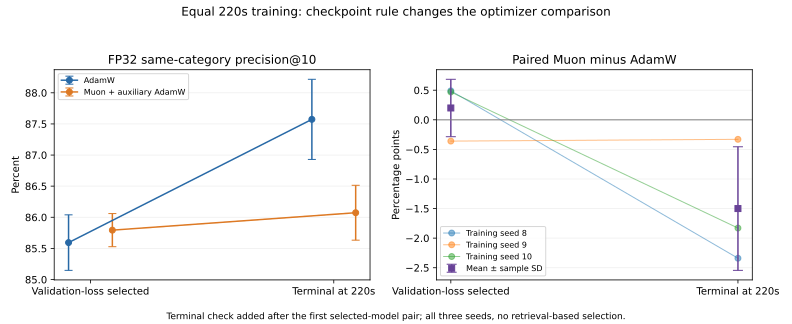

# Equal-time training and retrieval

The current Muon implementation has not demonstrated a robust equal-time retrieval advantage. Under the predefined classification-loss checkpoint rule, the paired Muon minus AdamW difference is +0.20 percentage points in FP32 and +0.53 points with Turbo2. The secondary terminal-model check reverses FP32: the paired difference becomes -1.50 points, with Muon winning 0/3 seeds. Report both comparisons; classification loss is not a direct retrieval-selection metric.

Both optimizers receive 220 seconds on the native Needle CPU backend. The model, Fashion-MNIST split, batch 64 and previously tuned learning rates are fixed. This compares existing configurations, not fully retuned equal-time optima.

Intermediate validation/checkpoint costs are inside the budget. Setup and the terminal evaluation/serialization are outside it for both methods. Updates are indivisible; actual overruns are recorded. Four common-time candidates at 55/110/165/220 seconds are selected by minimum validation loss, without retrieval-based selection.

| Method | Actual time, s | Updates | Dataset passes | Optimizer, ms/update | Other training, ms/update |
|---|---:|---:|---:|---:|---:|
| adamw | 220.003 ± 0.002 | 24053.333 ± 4618.260 | 27.969 ± 5.370 | 2.712 ± 0.457 | 6.618 ± 1.153 |
| muon | 220.015 ± 0.006 | 10613.000 ± 1868.902 | 12.341 ± 2.173 | 15.122 ± 2.943 | 6.049 ± 1.181 |

Means ± sample SD over training seeds 8/9/10. Paired initialization, split and epoch-order prefixes are verified. Throughput varies across runs on this shared Mac; method order alternates, and exact completed-step counts remain in the raw records.

## Same-category retrieval precision@10

Each selected model generates its own gallery and query embeddings. The gallery has 55,000 training-pool images, excluding the 5,000 validation images; queries are the same 1,000 previously explored official-test images. Values below are percentages: the fraction of ten retrieved pictures sharing the query category.

| Gallery store | AdamW | Muon + auxiliary AdamW | Paired Muon − AdamW, pp | Muon wins |
|---|---:|---:|---:|---:|
| fp32 | 85.593 ± 0.446 | 85.793 ± 0.266 | +0.200 ± 0.485 | 2/3 |
| uniform_2 | 85.203 ± 0.875 | 85.643 ± 0.302 | +0.440 ± 0.713 | 2/3 |
| uniform_4 | 85.550 ± 0.340 | 85.930 ± 0.306 | +0.380 ± 0.461 | 2/3 |
| turbo_2 | 85.283 ± 0.538 | 85.816 ± 0.257 | +0.532 ± 0.526 | 2/3 |
| turbo_4 | 85.607 ± 0.302 | 85.918 ± 0.242 | +0.311 ± 0.383 | 2/3 |

Turbo rotations 7/8/9 are averaged within training seed first. They are not nine independent trained models. Full raw summaries also retain recall of each model's own exact FP32 neighbors, persistent store bytes and query timings. Only gallery vectors are compressed; queries remain FP32. No query speedup is assumed.

## Terminal-model sensitivity check (FP32 only)

This secondary diagnostic was added after the first selected-model pair. It evaluates every terminal 220s model, without choosing models using retrieval. It checks whether classification-loss checkpoint selection changes the comparison.

| Optimizer | Validation-selected FP32, % | Terminal 220s FP32, % |
|---|---:|---:|
| adamw | 85.593 ± 0.446 | 87.573 ± 0.644 |
| muon | 85.793 ± 0.266 | 86.073 ± 0.441 |

Terminal paired Muon − AdamW: -1.500 ± 1.045 percentage points; Muon wins 0/3 seeds.



## Validation-based model selection

| Method | Seed | Selected time, s | Validation loss | Classification accuracy, % |
|---|---:|---:|---:|---:|
| adamw | 8 | 55.005 | 0.295665 | 88.56 |
| adamw | 9 | 110.000 | 0.289849 | 89.72 |
| adamw | 10 | 55.001 | 0.292192 | 89.46 |
| muon | 8 | 220.021 | 0.322760 | 88.20 |
| muon | 9 | 165.005 | 0.324202 | 88.88 |
| muon | 10 | 220.015 | 0.310160 | 89.42 |

All six selected checkpoints reproduce full-validation loss and accuracy after reloading. Classification accuracy is separate from retrieval precision. Historical ten-epoch studies had epoch-boundary checkpoint opportunities; this new experiment uses a common-time schedule, so differences also reflect checkpoint sampling.

## Why Muon costs more per update


Fixed deterministic gradients, current deep parameter shapes, ten warmup updates, 5 alternating blocks of 100 steps. No forward/backward computation is included. These are separate diagnostic runs after primary training/search timings; the terminal diagnostic ran separately afterwards.

| Method | Uninstrumented median, ms/update | Instrumented, ms/update | Instrumentation change, % |
|---|---:|---:|---:|
| adamw | 3.147 | 3.203 | +1.78 |
| muon | 18.643 | 18.888 | +1.32 |

### Hybrid update phases

| Phase | ms/update |
|---|---:|
| muon | 16.585 |
| auxiliary_adamw | 2.302 |
| ns_transform | 16.332 |

The NS transform is inside the Muon phase; do not add these nested times.

### Matrix products and native layout copies

| Operation | Calls/update | ms/update |
|---|---:|---:|
| NDArray matmul, including packing and dispatch | 45 | 15.207 |
| Native compact | 157 | 6.656 |
| Native matmul_tiled | 45 | 7.796 |

All native kernels total 16.472 ms/update; remaining Python dispatch/allocation/timer overhead is approximately 2.416 ms/update. The remaining term is not an isolated allocator measurement. NDArray matmul is inclusive of native matrix kernels and their layout copies; do not sum nested rows.

Three hidden matrices × five NS iterations × three products  = 45 extra matrix products per update. The native tiled path repacks both inputs and unpacks its output for every product. The generic Compact kernel computes strided indices per element, so layout work can be substantial even for small matrices.

The NS matrix products alone add approximately 138.94 million multiply/add FLOPs per update. The five dense layers' forward and two backward products at batch 64 are approximately 54.51 million FLOPs; this estimate excludes elementwise/loss work and all AdamW operations. Muon overhead is therefore material for this small batch. The author's [runtime analysis](https://kellerjordan.github.io/posts/muon/#runtime-analysis) also makes overhead depend on matrix size, NS iterations and batch size; its large-token-batch GPU examples do not predict this float32 CPU implementation.

The profiler preserves original update outputs bit-for-bit and restores every wrapped method/native function. Independent optimizer numerical-reference tests remain in the full suite. No formulas, NS counts or kernels were changed. The cProfile tables in JSON are a separate call-cost audit with additional overhead.


## Reproduction

```bash
python experiments/run_time_budget_study.py --phase all
python experiments/check_terminal_models.py
python experiments/profile_optimizer.py
python experiments/summarize_time_budget_study.py
```

The runner executes retained timings sequentially with CPU math thread limits set to one. Model/data/feature artifacts remain local and ignored; raw JSON, source hashes and plots are committed. The findings describe this float32 CPU implementation and these settings, not optimized bfloat16 GPU training.
